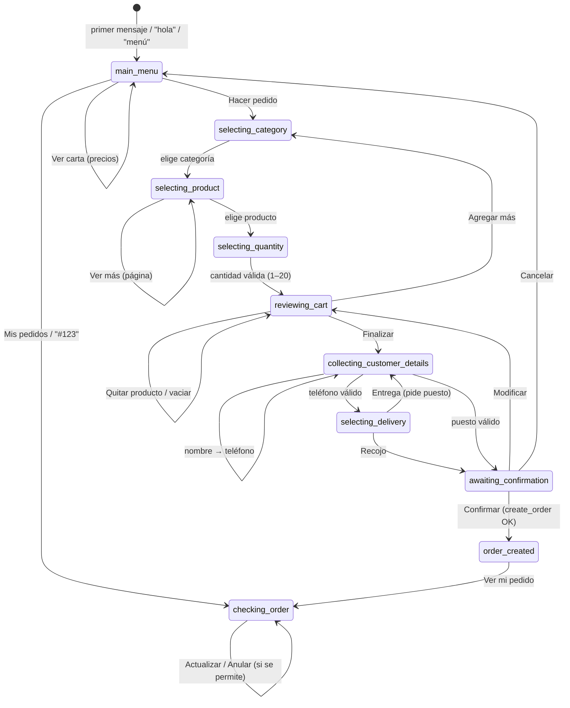

# 1. Plan técnico

## Revisión inicial del repositorio

El repositorio estaba vacío, sin commits, así que no había código previo que conservar. Todo se construyó desde cero siguiendo la arquitectura obligatoria: WhatsApp Cloud API, Supabase (Edge Functions, PostgreSQL y Auth), React/Vite/TypeScript, GitHub y Claude Code.

## Decisiones principales

| Decisión | Motivo |
|---|---|
| **Reglas de negocio en PostgreSQL** (`create_order`, `admin_set_order_status`, …) | Totales, disponibilidad, transiciones y propiedad del pedido se validan **dentro de una transacción**. Aunque el código TypeScript tuviera un error, la base de datos no acepta datos inválidos. |
| **Precios en céntimos** (`integer`) | Evita errores de redondeo (0.1 + 0.2 ≠ 0.3). |
| **Máquina de estados pura** (`_shared/bot/state-machine.ts`) | Recibe la sesión y el mensaje, y devuelve la nueva sesión y las respuestas. No envía nada por su cuenta, así se puede probar sin red. |
| **Sesión guardada en la BD con versión** (bloqueo optimista) | Si una persona toca dos botones muy rápido, dos invocaciones podrían pisarse. Con la versión, la segunda detecta el cambio y vuelve a procesar con la sesión actualizada. |
| **Deduplicación doble** | `processed_messages` evita procesar dos veces el mismo webhook. `idempotency_key` evita crear dos pedidos si el cliente toca "Confirmar" dos veces. |
| **Botones y listas interactivas + números** | Un toque es más rápido que escribir (hora punta de 6 a 9 a. m.). También se puede responder "1", "2" o escribir palabras como "jugos" o "papaya". |
| **Pedido RECIBIDO ≠ ACEPTADO ≠ LISTO** | El bot nunca dice "aceptado" hasta que la dueña lo acepta (salvo que ella active la aceptación automática en Ajustes). |
| **Sin IA generativa** | Todo es determinista: menús, precios y validaciones salen de reglas y de la base de datos. |
| **La función del panel no usa la service role** | Actúa con la sesión de la dueña, y la BD vuelve a verificar que sea administradora. |
| **Panel en GitHub Pages** | Hosting gratuito. Solo lleva valores públicos (URL y clave anon); la seguridad la dan Auth y RLS. |

## Máquina de estados



**Comandos que funcionan en cualquier estado:** `menú`/`hola` (vuelve al inicio **sin perder el carrito**), `carrito`, `volver`, `cancelar` (borra el pedido en curso), `mis pedidos`, `ayuda`.

**Ante cualquier mensaje inesperado** (texto que no corresponde, audio, foto, sticker, botón de un mensaje viejo) el bot explica qué hacer y repite la pregunta actual. El carrito se conserva.

**La sesión caduca** tras 6 horas sin actividad: el carrito de ayer no aparece hoy. El nombre y el puesto sí se recuerdan para el próximo pedido.

## Modelo de datos

| Tabla | Para qué | Puntos clave |
|---|---|---|
| `products` | Carta | `price_cents`, `is_available` (agotado), `is_active` (archivado) |
| `orders` | Pedidos | `order_number` (#101), `customer_wa_id` (dueño del pedido), `status`, `total_cents`, `idempotency_key` única |
| `order_items` | Detalle | `product_name` y `unit_price_cents` **copiados al comprar** |
| `order_status_history` | Auditoría | quién cambió qué y cuándo |
| `customer_sessions` | Estado de la conversación | `state`, `cart`, `context`, `profile`, `version`, `last_inbound_at` (ventana de 24 h), `marketing_opt_in` (siempre `false`) |
| `processed_messages` | Deduplicación | solo el id del mensaje y su estado; **sin contenido ni teléfono** |
| `business_settings` | Reglas configurables | pausa, entrega, aceptación automática, anulación, máximos |
| `admins` | Quién puede usar el panel | ids de Supabase Auth |

### Estados de un pedido

```
pending (RECIBIDO) ──► confirmed (ACEPTADO) ──► preparing ──► ready (LISTO) ──► delivered
   │                        │                       │              │
   └────────────────────────┴───────────────────────┴──────────────┴──► cancelled
```

- El **cliente** solo puede anular un pedido `pending` (o `confirmed`, si la dueña lo permite en Ajustes).
- La **dueña** solo puede hacer las transiciones de la figura (función `order_transition_allowed`).
- Ningún texto del cliente cambia estados: la máquina de estados no tiene ninguna acción que lo haga, y la base de datos lo impide.

## Modelo de seguridad

| Actor | Clave | Qué puede hacer |
|---|---|---|
| Cualquiera en internet | clave anon (pública) | **Nada.** Sin privilegios de tabla y sin funciones. |
| Usuario con sesión que **no** es admin | JWT | Nada: RLS devuelve 0 filas y las funciones responden `NOT_AUTHORIZED`. |
| Dueña (admin) | JWT | Leer pedidos; crear y editar productos; editar ajustes; cambiar estados **solo** con `admin_set_order_status`. No puede editar ni borrar pedidos directamente. |
| Edge Function del webhook | service role (solo en el servidor) | Ejecutar las funciones del bot. Las funciones filtran por el número que escribe. |
| Meta | firma HMAC con el App Secret | Enviar webhooks. Si la firma no es válida, se rechazan. |

Todo esto está cubierto por pruebas: `supabase/tests/10_orders_test.sql` y `supabase/functions/tests/*.ts`.

## Etapas y dónde está cada una

| # | Etapa | Archivos | Prueba |
|---|---|---|---|
| 1 | Plan técnico | este documento | — |
| 2 | Estructura | `README.md`, carpetas | — |
| 3 | Migraciones SQL | `supabase/migrations/*.sql` | `scripts/test-sql.sh` |
| 4 | Máquina de estados | `_shared/bot/state-machine.ts` | `tests/state_machine_test.ts` |
| 5 | Lógica de pedidos | `create_order` y siguientes (SQL), `supabase-repository.ts` | SQL + Deno |
| 6 | Webhook de Meta | `whatsapp-webhook/handler.ts`, `signature.ts`, `webhook-parser.ts` | `tests/webhook_test.ts` |
| 7 | Envío de mensajes | `whatsapp/client.ts`, `payloads.ts` | `tests/whatsapp_test.ts` |
| 8 | Panel móvil | `admin/` | `npm run build` |
| 9 | Seguridad, duplicados y errores | en todos los anteriores | todas |
| 10 | Despliegue | `docs/02-guia-paso-a-paso.md` | verificación manual |
